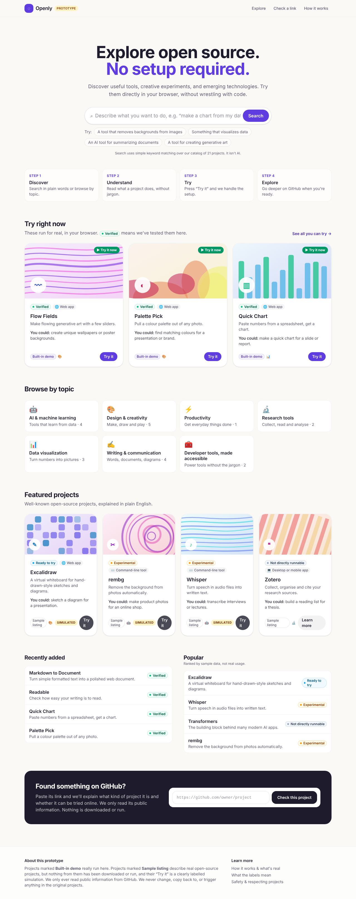
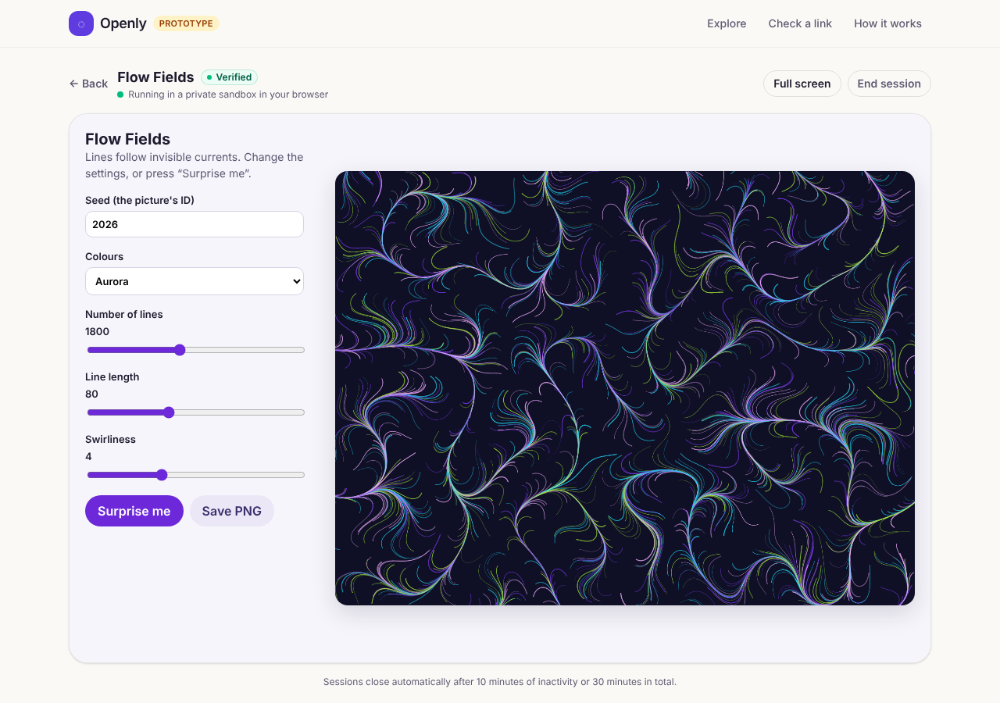
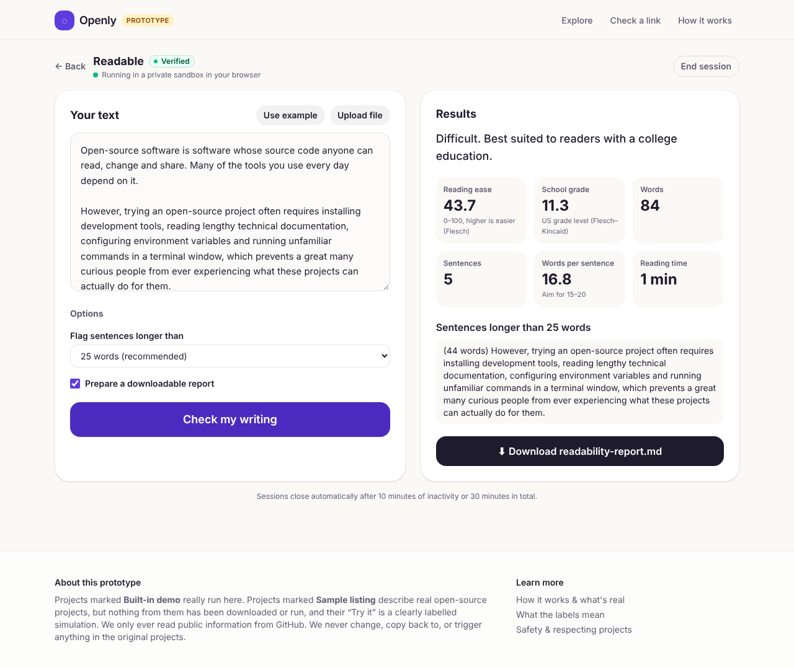
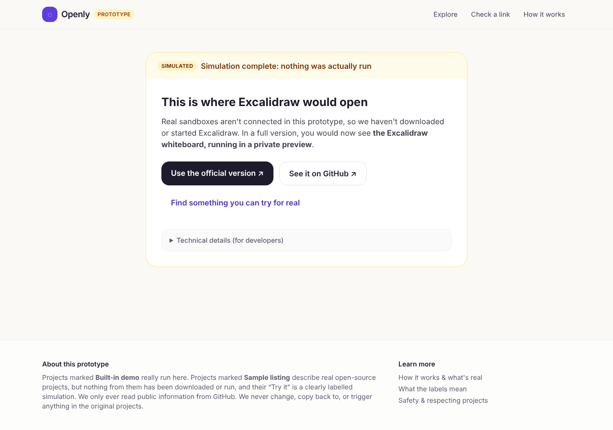
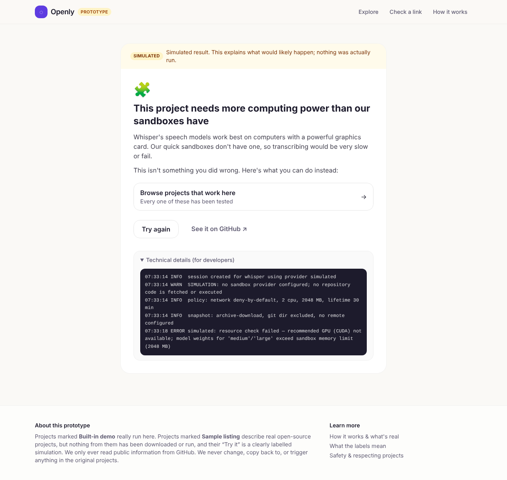

# Openly: a no-code sandbox for open source

A working prototype that helps people with little or no coding experience **discover, understand and try** open-source projects without touching GitHub, a terminal or an installer.

> Discover → Understand → Try → Explore



## Quick start

```bash
npm install
npm run dev          # http://localhost:3000
npm test             # 108 unit tests
npm run typecheck
npm run build && npm start
```

Requires Node 20 or newer. No accounts, API keys or databases are needed. `GITHUB_TOKEN` is optional (see `.env.example`).

## What's real and what isn't

The product's core principle is to hide unnecessary technical complexity without hiding a project's limitations. The prototype follows the same rule about itself:

| Feature | Status |
| --- | --- |
| Browse, search and read project pages | **Real.** Local catalog of 21 projects |
| Natural-language search | **Real keyword search** (stop words, stemming, synonyms). Not AI, and the UI says so |
| Built-in demos: Flow Fields, Palette Pick, Quick Chart (web apps) | **Really run** in a sandboxed iframe (`allow-scripts`, opaque origin, strict CSP) |
| Built-in demos: Readable, Markdown to Document (command-line tools turned into forms) | **Really run** through server-side tool adapters |
| "Check a GitHub link" analysis | **Real, read-only.** Reads public metadata and config files, then classifies the project. Nothing is executed |
| "Try it" for GitHub sample listings | **Simulated** and labelled as such everywhere. No real sandbox is connected |
| AI-assisted setup | **Interface only.** No model is connected, and the UI says so |

Only built-in demos can carry the **Verified** status. A test enforces this rule.

## Screens

| | |
| --- | --- |
|  |  |
|  |  |

## Protecting the projects we host

These rules are enforced in code (`src/lib/safety/workflow-protection.ts`) and covered by tests:

- The GitHub client can only send `GET`/`HEAD` requests, and only to a fixed list of public read-only endpoints. Requests to endpoints such as pulls, issues, forks, refs, hooks or workflow dispatches are refused before any network call is made.
- Sandboxes receive a **detached archive snapshot**: no `.git` directory and no remote, so there is nothing to push to. The `.github/` directory is ignored by the executor, so a project's Actions are never triggered.
- Commands from a sandbox or a future AI agent are screened. `git push`, `git remote add/set-url`, `git credential`, the `gh` CLI and write requests to `api.github.com` are all blocked.
- The sandbox policy is deny-by-default: no credentials, no host mounts, capped resources, a 10-minute idle timeout and a 30-minute lifetime. It cannot be configured to reach GitHub.

See [docs/ARCHITECTURE.md](docs/ARCHITECTURE.md) for the module layout and the path to production.
